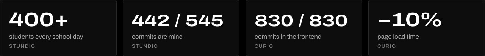

  

  I design, build and launch web apps — from the first commit to the live site.

  

## Selected work

Live products first. Every project links to the site or the code.

| Project | What it is | Stack |
| --- | --- | --- |
| [**Pro-lifts**](https://pro-lifts.lv) | Client site. The website of Pro-lifts SIA in Riga, in Latvian, Russian and English, with a video hero that plays as you scroll. | Next.js 16, Sanity, next-intl, GitHub Actions |
| [**Stundio**](https://app.stundio.lv) · [code](https://github.com/dmytropolizhai/stundio) | Open source. An unofficial timetable app for students at Riga State Technical School, on web, Android and Linux. | React 19, TypeScript, Vite, Capacitor, Tauri |
| [**Curio**](https://curio.today) · [code](https://github.com/curio-today/frontend) | Built for Curio's founder. A feed of short news stories. I rebuilt its frontend in Next.js, with support for several languages. | Next.js 16, React 19, TypeScript, next-intl, TanStack Query |
| [**Numerologgi**](https://shop.numerologgi.com) | Client shop. An online shop for planners, with a CMS catalogue and card payments. | Next.js 16, Payload, Postgres, Stripe, three.js |
| [**Zinly**](https://zinly.polizhai.dev) | Co-founded app. An AI learning app that reads a student's calendar and fills every free gap with a short lesson. | n/a |

## Stack

**Frontend** Next.js, React 19, TypeScript 
**Content** Sanity, Payload 
**Data** Postgres 
**Infrastructure** Docker, GitHub Actions, Linux (Arch)

## Contact

- Email: [dmytropolizhai@gmail.com](mailto:dmytropolizhai@gmail.com)
- Telegram: [t.me/dmytropolizhai](https://t.me/dmytropolizhai)
- Book a briefing call: [cal.com/dmytropolizhai/briefing](https://cal.com/dmytropolizhai/briefing)
- Site: [polizhai.dev](https://polizhai.dev)
- LinkedIn: [linkedin.com/in/dmytropolizhai](https://www.linkedin.com/in/dmytropolizhai)

  

